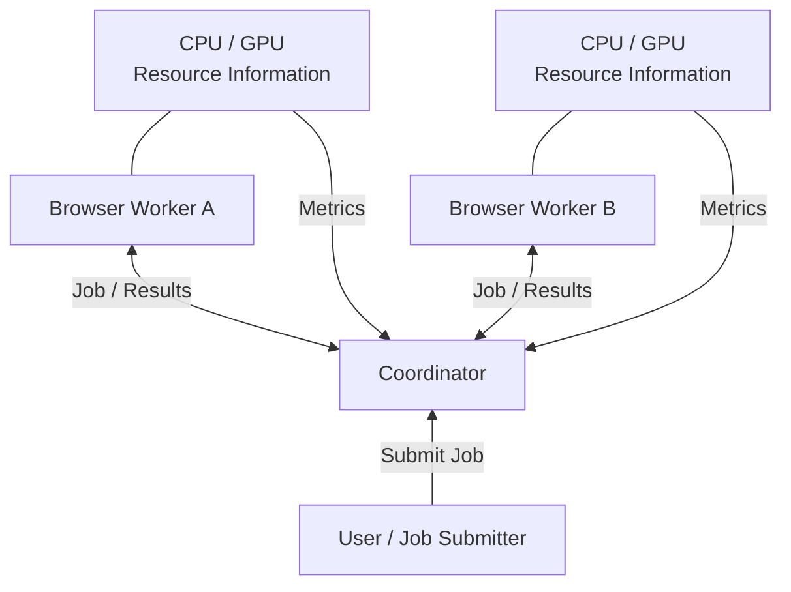
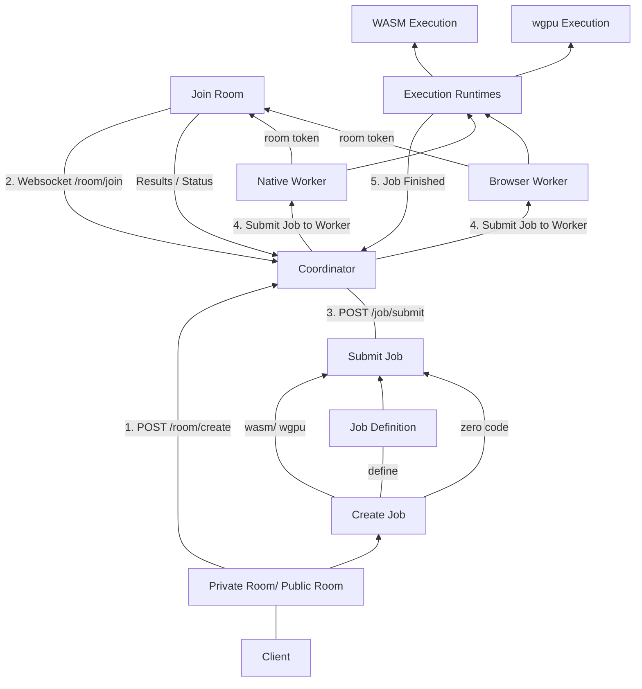
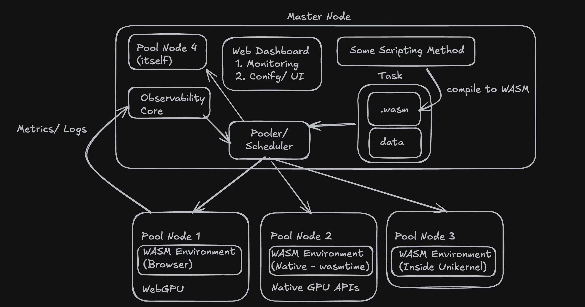

# Browser First Compute Pooling

Pool idle CPU/GPU resources across browsers and execute CPU and GPU jobs remotely,
mainly via WebAssembly and WebGPU/wgpu.

## Architecture

**Overview**

**Job flow**

**Initial vision**

## Quick start

- Backend: `cd coordinator && go run ./cmd/coordinator`
- Frontend: `cd ui && npm run dev`

Coordinator on `http://localhost:3000`, UI on `http://localhost:8080`.

## Docs

- [Roadmap](docs/ROADMAP.md)
- [Diagrams](docs/architecture)
