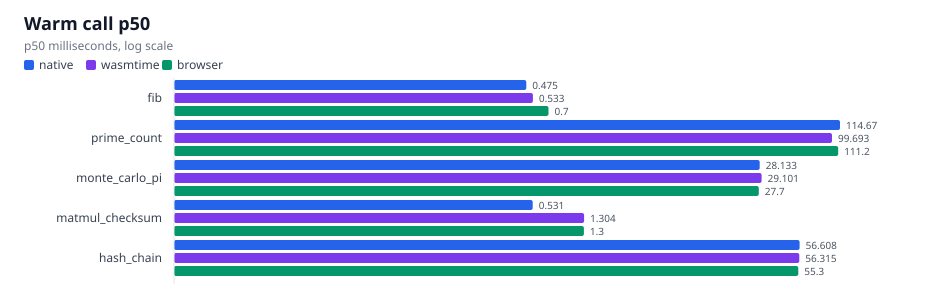
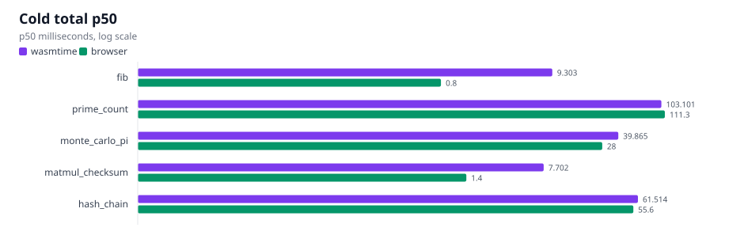

# WASM benchmark report

Warm call = repeated invocation on a pre-instantiated module.
Cold total = compile + instantiate + first call (p50).

| case | result | native warm p50 (ms) | wasmtime warm p50 (ms) | wasmtime cold total (ms) | browser warm p50 (ms) | browser cold total (ms) |
|---|---|---|---|---|---|---|
| fib | 1,884,755,131 | 0.475 | 0.533 | 9.303 | 0.700 | 0.800 |
| prime_count | 148,933 | 114.670 | 99.693 | 103.101 | 111.200 | 111.300 |
| monte_carlo_pi | 3.142 | 28.133 | 29.101 | 39.865 | 27.700 | 28.000 |
| matmul_checksum | 1,344,449,826 | 0.531 | 1.304 | 7.702 | 1.300 | 1.400 |
| hash_chain | 2,488,766,478 | 56.608 | 56.315 | 61.514 | 55.300 | 55.600 |

## Warm call

## Cold total

- native: 5 iterations, 2 warmup
- wasmtime: 5 iterations, 2 warmup
- browser: 5 iterations, 2 warmup
- browser UA: Mozilla/5.0 (Macintosh; Intel Mac OS X 10_15_7) AppleWebKit/537.36 (KHTML, like Gecko) HeadlessChrome/159.0.8154.6 Safari/537.36
